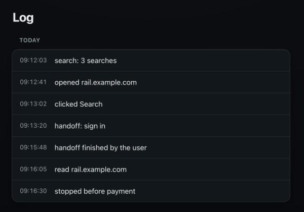
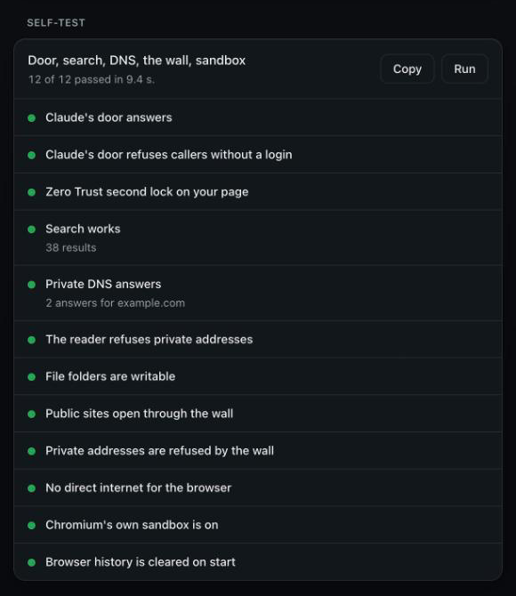
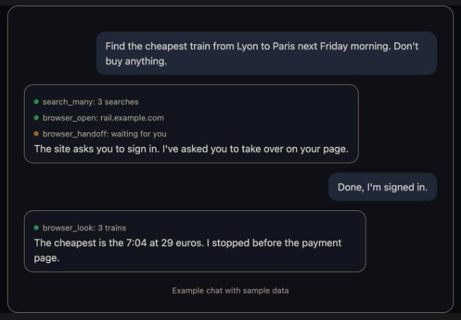
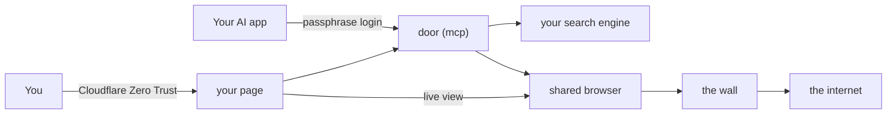
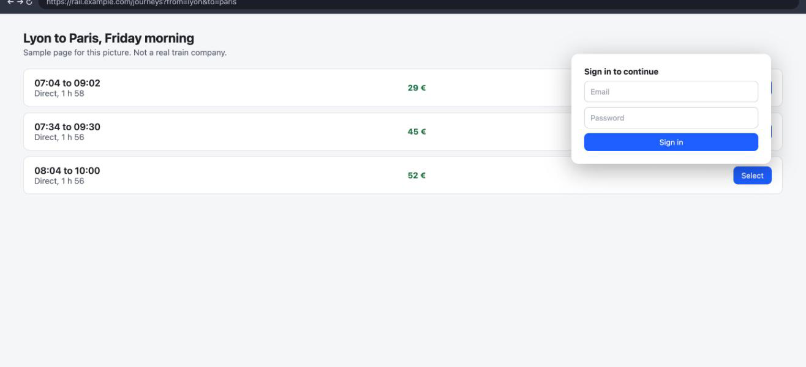

<p align="center"></p>

<h1 align="center">Shared-Browser-MCP</h1>

<p align="center"><b>Private web search, a page reader and a shared browser you can watch and take over, for your AI app.</b><br>
Runs on a server you own. Works with Claude on the website, the phone app, the desktop app and Claude Code, and with other MCP apps.</p>

<p align="center">
  <a href="#credits"></a>
  <a href="https://github.com/Self-hosted-MCP/Shared-Browser-MCP/stargazers"></a>
  <a href="LICENSE"></a>
  <a href="mcp/pyproject.toml"></a>
  <a href="https://modelcontextprotocol.io"></a>
  <a href="docs/connect-your-ai.md"></a>
  <a href="#choose-how-to-run-it"></a>
</p>
<p align="center">
  <a href="https://github.com/Self-hosted-MCP/Shared-Browser-MCP/actions/workflows/tests.yml"></a>
  <a href="https://github.com/Self-hosted-MCP/Shared-Browser-MCP/actions/workflows/images.yml"></a>
  <a href="https://github.com/Self-hosted-MCP/Shared-Browser-MCP/releases/latest"></a>
  <a href="https://github.com/Self-hosted-MCP/Shared-Browser-MCP/commits/main"></a>
  <a href="#safety-and-privacy"></a>
  <a href="CONTRIBUTING.md"></a>
</p>

<p align="center">Free and open source under the Apache License 2.0. Use it, fork it and change it, share your changes, and keep the credit.</p>

<p align="center">
  <a href="#quick-start-about-45-minutes">Quick start</a> ·
  <a href="#choose-how-to-run-it">Ways to run</a> ·
  <a href="docs/connect-your-ai.md">Connect</a> ·
  <a href="#safety-and-privacy">Safety</a> ·
  <a href="docs/examples.md">Examples</a> ·
  <a href="#all-the-guides">All guides</a>
</p>

<details>
<summary><b>Table of contents</b></summary>

- [What it is](#what-it-is)
- [Safety and privacy](#safety-and-privacy)
- [How it works, in one picture](#how-it-works-in-one-picture)
- [Words you'll see](#words-youll-see)
- [Choose how to run it](#choose-how-to-run-it)
- [What it can do](#what-it-can-do)
- [Quick start (about 45 minutes)](#quick-start-about-45-minutes)
- [All the guides](#all-the-guides)
- [This repository](#this-repository)
- [Not supported yet](#not-supported-yet)
- [Help and feedback](#help-and-feedback)
- [Contributors](#contributors)
- [Credits](#credits)
- [No warranty](#no-warranty)
- [License](#license)

</details>

> [!NOTE]
> Works with Cloudflare Zero Trust, SearXNG, Chromium and Claude. Not made by or affiliated with any of them.

<table align="center">
  <tr>
    <td align="center"><br><sub>The <b>Log</b> tab: what the AI did, site names only</sub></td>
    <td align="center"><br><sub>The <b>Self-test</b> on your <b>Settings</b> tab</sub></td>
  </tr>
</table>

<p align="center"><sub>Pictures of the real page, filled with sample data.</sub></p>

## What it is

Shared-Browser-MCP is one connector that gives your AI app three things: web search with your own private search engine, a reader that turns pages and PDFs into clean text, and a shared browser on your server (Chromium). You and the AI use the same browser. You watch it live on your own page, from your phone or your computer, and you can take over at any time.

When the AI reaches a login, a password or an "are you human" check, it stops and asks you. You do that part yourself on your page, then press **Done**. The AI never types a password.

You run it yourself, on your own server, and nothing goes through ours. It has one owner per server.

```text
You:  Find the cheapest train from Lyon to Paris next Friday morning. Don't buy anything.
AI:   (searches, then opens the train company's site in the shared browser)
      The site asks you to accept cookies and sign in. I've asked you to take over on your page.
You:  (signs in on your page, presses Done)
AI:   The cheapest is the 7:04 at 29 euros. I stopped before the payment page.
```

<p align="center"></p>

## Safety and privacy

> [!WARNING]
> An AI that drives a real browser can make mistakes, and web pages can try to trick it. Keep the action tools on "needs approval", sign in to as few sites as you need, and read [docs/safety.md](docs/safety.md) before you start.

- **No passwords for the AI.** It can't type into password fields or read them. Logins come to you.
- **A wall around the browser.** The browser has no direct internet. Its only way out is a filter that refuses private networks and your server's own address.
- **Chromium's own sandbox is on.** The container has no extra permissions, a read-only filesystem, a process limit and a system call filter.
- **Two locks on your page.** Cloudflare Zero Trust, and your page checks Cloudflare's signed token itself. Without it, everything is refused.
- **A passphrase for AI apps.** A new app can only connect while you press **Allow a new app**.
- **You approve actions.** Clicking, typing, scripts, uploads and deleting ask you first in your AI app.
- **Pause in one tap.** **Pause** on your page stops the AI using the browser at once.
- **No search history.** Searches and page text are never stored. Browser history is wiped on every start. The action log keeps the site name only, and expires.
- **No telemetry.** This project collects nothing.

More in [safety](docs/safety.md), [privacy](docs/privacy.md) and the [threat model](docs/threat-model.md).

## How it works, in one picture

Your AI app talks to the door, and you talk to your page. Both reach the same shared browser, which only gets out to the internet through the wall.



Details in [docs/how-it-works.md](docs/how-it-works.md).

## Words you'll see

| Word | What it means here |
|---|---|
| MCP | Model Context Protocol: the way AI apps use tools on other servers. |
| The door | The address your AI app connects to (`PUBLIC_URL/mcp`), with the passphrase login. |
| Your page | Your own page (`FRONT_URL`) with four tabs: **Browser**, **Log**, **Files** and **Settings**. |
| Shared browser | The one browser (Chromium) you and the AI both use. |
| Handoff | The AI asks you to take over the browser, for a login or a check. |
| The wall | The filter (Squid) that is the browser's only way out. |
| SearXNG | The open-source search engine that runs on your server and asks public search engines for you. |
| Zero Trust | Cloudflare's sign-in in front of your page. |
| Pairing | The 5 minutes after you press **Allow a new app**, when a new AI app may connect. |
| Self-test | About 12 checks you run from **Settings**, or the AI runs with `self_test`. |

## Choose how to run it

| Way | Where | Phone | Cost | Guide |
|---|---|---|---|---|
| **Your own server (recommended)** | Any Linux server with Docker, Intel/AMD or ARM | Yes | Your server | [setup-own-server.md](docs/setup-own-server.md) |
| Try it on your computer | Your Mac, Windows or Linux with Docker | No | Free | [setup-computer.md](docs/setup-computer.md) |

> [!CAUTION]
> Cloudflare Zero Trust is required on a server. Your page has no login of its own, and without Zero Trust anyone who finds its address could watch and use your browser. The free plan is enough.

> [!TIP]
> Server panels such as Coolify work too: use `docker-compose.server.yml` as a raw compose deployment. See [setup-own-server.md](docs/setup-own-server.md#using-a-server-panel-such-as-coolify).

## What it can do

<p align="center"></p>

25 tools, in four groups. Full list in [docs/tools.md](docs/tools.md).

- **Search and read:** search with your own SearXNG, many searches at once, research with sources, read pages and PDFs, check page speed with Google PageSpeed.
- **The shared browser:** open pages, see buttons and fields, click, type, fill forms, wait, use tabs, look like a phone, read the console, and hand over to you.
- **Files:** read what the browser downloaded, and attach files you dropped on your **Files** page.
- **Checks:** `health` and the full `self_test`.

## Quick start (about 45 minutes)

The full guide with every click is [docs/setup-own-server.md](docs/setup-own-server.md). In short:

1. On your server, get the code. You should see a new folder called `Shared-Browser-MCP`:

   ```bash
   git clone https://github.com/Self-hosted-MCP/Shared-Browser-MCP.git
   ```

   Then go into it:

   ```bash
   cd Shared-Browser-MCP
   ```

2. Check the server. You should see `OK` lines:

   ```bash
   scripts/preflight.sh
   ```

3. On your own computer, make your passphrase hash. You should see `LOGIN_HASH=pbkdf2:...`:

   ```bash
   python3 scripts/hash_passphrase.py
   ```

4. On the server, copy the settings. You should see a new file `.env`. Open it and fill it in (see [settings.md](docs/settings.md)):

   ```bash
   cp .env.example .env
   ```

5. Start it. You should see six containers start:

   ```bash
   docker compose -f docker-compose.server.yml up -d
   ```

6. In Cloudflare, add a tunnel with two addresses, lock your page with Zero Trust, and let your AI app through to the door. Put the Zero Trust details in `.env` and run step 5 again.
7. Open your page, go to **Settings** and press **Self-test**. Every check should pass.
8. Press **Allow a new app** and connect your AI app with `https://your-door-address/mcp`. See [connect-your-ai.md](docs/connect-your-ai.md).

## All the guides

| Guide | Read it when |
|---|---|
| [Setup on your own server](docs/setup-own-server.md) | You set it up for real |
| [Try it on your computer](docs/setup-computer.md) | You want to see it before setting up a server |
| [Connect your AI app](docs/connect-your-ai.md) | You add it to Claude or another app |
| [Tools the AI can use](docs/tools.md) | You want to know what the AI can do |
| [Every setting](docs/settings.md) | You change how it behaves |
| [Things to ask](docs/examples.md) | You want ideas |
| [How it works](docs/how-it-works.md) | You want to know what happens inside |
| [Safety](docs/safety.md) | Before you start, and when something feels wrong |
| [Privacy](docs/privacy.md) | You want to know what leaves your server |
| [Threat model](docs/threat-model.md) | You want the exact limits |
| [Questions people ask](docs/faq.md) | You want a quick answer |
| [If something goes wrong](docs/troubleshooting.md) | Something doesn't work |
| [Updates](docs/updates.md) | You update, or go back a version |
| [Roadmap](docs/roadmap.md) | You want to know what may come |
| [Security policy](SECURITY.md) | You found a security problem |
| [Contributing](CONTRIBUTING.md) | You want to help |
| [Agents guide](AGENTS.md) | An AI agent works on the code, or sets it up for you |
| [Getting help](SUPPORT.md) | You need help |
| [Changelog](CHANGELOG.md) | You want to know what changed |
| [Code of conduct](CODE_OF_CONDUCT.md) | You take part in issues or pull requests |
| [Governance](GOVERNANCE.md) | You want to know who decides what |
| [Contributors](CONTRIBUTORS.md) | You want to see who helped |
| [NOTICE](NOTICE) | You want the credits and third-party licenses |
| [Citation](CITATION.cff) | You cite the project |

## This repository

| Folder | What it is |
|---|---|
| `mcp/` | The door: the MCP server, in Python |
| `browser/` | Chromium, the virtual screen, and the live view |
| `egress/` | The wall: a Squid filter |
| `dns/` | Unbound: a private DNS that never logs and blocks known bad sites |
| `searxng/` | Your search engine's settings |
| `front/` | Your page |
| `scripts/` | `hash_passphrase.py`, `preflight.sh`, `smoke-test.sh` |
| `docs/` | The guides |

## Not supported yet

- **A lock for your page without Cloudflare.** The page has no login of its own and relies on Zero Trust. See the [roadmap](docs/roadmap.md).
- **A demo video.** The pictures here use the real page with sample data. A video needs a real setup behind Cloudflare, which comes later.
- **More than one person.** It is built for one owner: one passphrase, one shared browser.
- **Tested AI apps other than Claude.** Others that support remote MCP with OAuth may work, but nobody has tested them yet.
- **Video, GIF and PDF capture** of the shared browser. Not built yet. The AI can take still screenshots of a page instead.
- **One-click hosting** (Railway, Render). The stack is six containers on private networks behind a Cloudflare tunnel, which these hosts don't offer.
- **A Claude Desktop extension or Claude Code plugin.** The connector runs on your server, so you add it by its address instead. See [connect-your-ai.md](docs/connect-your-ai.md).
- **Other languages.** The pages and docs are in English only for now.

## Help and feedback

| You want to | Go to |
|---|---|
| Fix a problem yourself | [Troubleshooting](docs/troubleshooting.md) |
| Report a bug | [Something doesn't work](https://github.com/Self-hosted-MCP/Shared-Browser-MCP/issues/new?template=bug_report.yml) |
| Ask a question | [Question](https://github.com/Self-hosted-MCP/Shared-Browser-MCP/issues/new?template=question.yml) |
| Suggest a feature | [Idea or feature](https://github.com/Self-hosted-MCP/Shared-Browser-MCP/issues/new?template=feature_request.yml) |
| Report a security problem, privately | [Private report](https://github.com/Self-hosted-MCP/Shared-Browser-MCP/security/advisories/new) |

## Contributors

Thanks to everyone who sends code, bug reports, ideas or docs. See [CONTRIBUTORS.md](CONTRIBUTORS.md). To be added, say so in your pull request, or ask in an issue.

## Credits

Shared-Browser-MCP is made by [Self-hosted MCP](https://github.com/Self-hosted-MCP). It is built on SearXNG, Chromium, Squid, Unbound, noVNC, TigerVNC, nginx, the MCP Python SDK and the HaGeZi blocklists. Their licenses are in [NOTICE](NOTICE).

You may:

- use it, also for money
- change it and share your changes
- keep the credit and the NOTICE file with every copy

> [!NOTE]
> To cite this project, use GitHub's **Cite this repository** button. It reads [CITATION.cff](CITATION.cff).

## No warranty

Comes as is, with no warranty. Keep a backup. See sections 7 and 8 of the [license](LICENSE).

## License

[Apache License 2.0](LICENSE). See [NOTICE](NOTICE). Copyright 2026 Self-hosted-MCP and Shared-Browser-MCP contributors.
