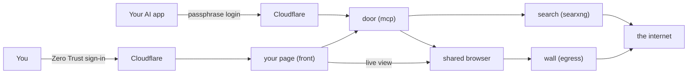

# How it works

For when you want to know what happens inside, in plain words.

## The pieces

| Piece | What it is |
|---|---|
| Your AI app | Claude or another app that speaks MCP. It calls the tools. |
| The door (`mcp`) | The MCP server. It checks the login, runs the tools, and keeps the action log. |
| Your page (`front`) | Your own page with the live browser, the log, your files and the settings. Locked by Cloudflare Zero Trust. |
| The search engine (`searxng`) | Your own SearXNG. It asks public search engines for you, with no account and no history. |
| The shared browser (`browser`) | A real Chromium on a virtual screen. You and the AI see the same window. |
| The wall (`egress`) | A filter that is the browser's only way out. It refuses private networks and your server's own address. |
| The DNS (`dns`) | Looks up website names for every piece, never logs them, and blocks known bad sites. |

## What happens when you ask

1. You ask your AI app something, like *find the opening hours of the museum and check if they are open on Monday.*
2. The AI calls `web_search`. Your SearXNG asks a few public search engines and returns the results. Nothing is saved.
3. The AI calls `read_url` on the best result. The page reader fetches it and returns clean text, marked as data, not instructions.
4. If the page needs JavaScript or clicking, the AI calls `browser_open` and `browser_look`. You can watch it on your page.
5. The AI answers, with the addresses it used.

## When the AI wants to change something

1. The AI calls `browser_act`, for example to fill a form.
2. Your AI app asks you to approve, because the tool is marked as one that changes something.
3. If the page has a password field or an "are you human" check, the AI calls `browser_handoff`. Your page shows its message and a **Done** button. You log in yourself, then press **Done**.
4. Every action goes into the action log on your **Log** tab: what was done and on which site, never the text typed.

## What's stored

| What | Where | How long |
|---|---|---|
| Your settings | `mcp-data` volume | Until you change them |
| The action log | `mcp-data` volume | 7 days by default (change it on **Settings**) |
| Connected apps and token hashes | `mcp-data` volume | Until you disconnect the app |
| Your sign-ins in the shared browser | `browser-profile` volume | Until you sign out or remove the volume |
| Browser history | Nowhere | Wiped on every start |
| Downloads and uploads | `downloads` and `uploads` volumes | 3 days by default |
| Searches and page text | Nowhere | Never stored |

## The code

The MCP server is Python, in `mcp/src/sbmcp/`. Each of the six pieces has its own folder and its own image. [AGENTS.md](../AGENTS.md) has the map.

What next: [how it stays safe](safety.md).
